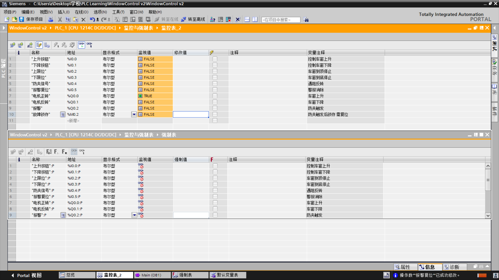
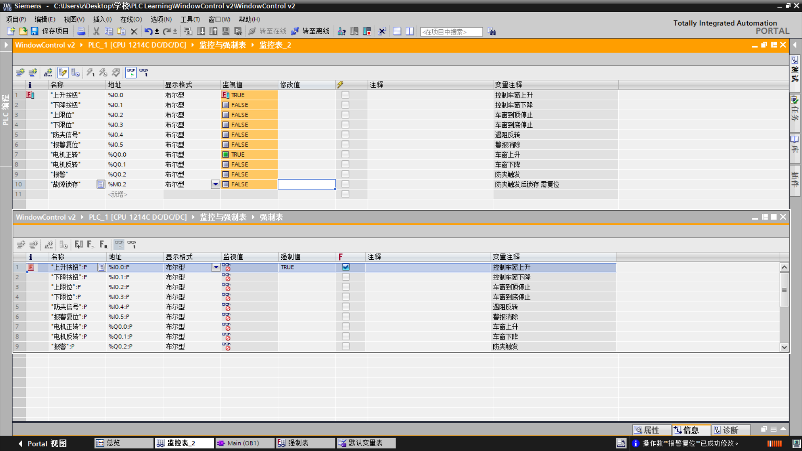
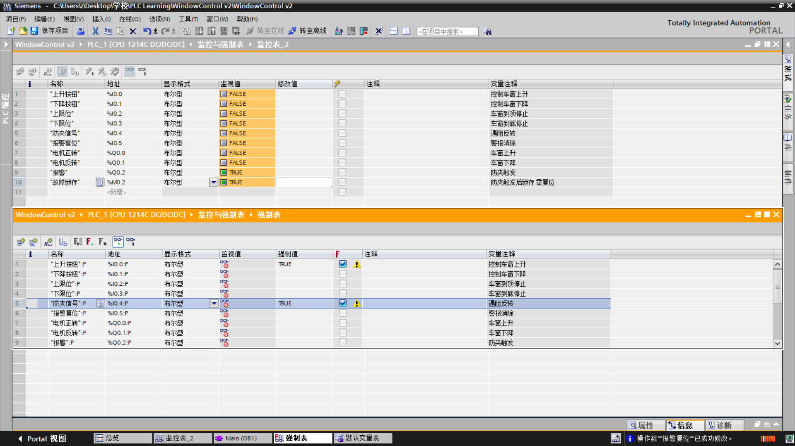
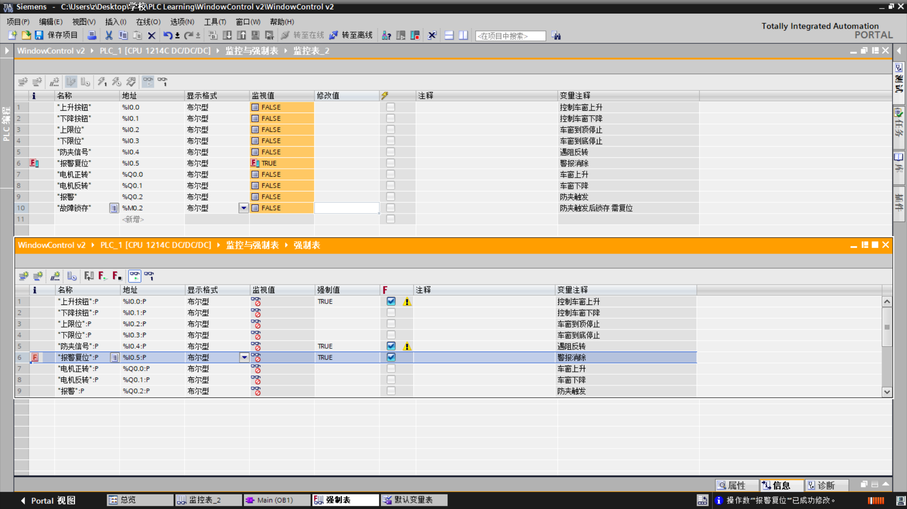
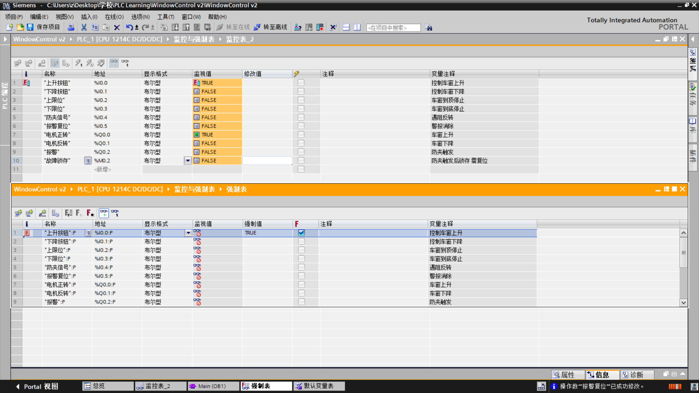

# 测试记录

本项目全部功能在 S7-PLCSIM 中逐条验证，记录每一次激励、预期与实际结果。

---

## 1. 测试环境

| 项目 | 内容 |
|---|---|
| PLC | S7-1200 CPU 1214C DC/DC/DC |
| 软件 | TIA Portal V16 |
| 仿真 | S7-PLCSIM V16 |
| 程序块 | Main [OB1] |
| 激励方式 | 强制表（I 区）+ 监控表修改值（M 区） |
| 记录方式 | 监控表截图 + 梯形图在线监视 |

### 激励方式说明

测试中发现两个必须区分的情况：

| 区域 | 能否强制 | 采用方式 | 原因 |
|---|---|---|---|
| I / Q | 可以 | **强制表** | 监控表"修改值"只写一次，会被过程映像刷新覆盖 |
| M / DB | 不可以 | **监控表修改值** | S7-1200 不支持强制 M 区；M 区不会被刷新，改值可稳定保持 |

> S7-1200 的强制表只支持 I 和 Q，M 区无法强制，这是 CPU 的限制。

---

## 2. 基线测试（v1，改造前）

目的：确认原始程序的真实行为，作为改造的对照基准。

**逻辑**：`(I0.0 ∨ Q0.0) ∧ ¬I0.1 ∧ ¬I0.2 ∧ ¬I0.4 → Q0.0`

| # | 激励 | 预期 | 实测 | 结果 |
|---|---|---|---|---|
| 1 | I0.0 = 1 | Q0.0 亮 | Q0.0 亮 | 通过 |
| 2 | 保持 I0.0，I0.2 = 1 | Q0.0 灭 | Q0.0 灭 | 通过 |
| 3 | I0.2 恢复 0 | **Q0.0 自动恢复亮** | 自动恢复 | 通过（暴露问题） |
| 4 | I0.0 = 0（松手） | Q0.0 保持亮（自锁） | 保持亮 | 通过 |
| 5 | 松手状态下 I0.2 = 1 | Q0.0 灭 | 灭 | 通过 |
| 6 | I0.2 恢复 0 | Q0.0 保持灭 | 保持灭 | 通过 |
| 7 | I0.0 = 1、I0.1 = 1 | Q0.0 灭（互锁） | 灭 | 通过 |
| 8 | I0.0 = 1、I0.4 = 1 | Q0.0 灭（防夹） | 灭 | 通过 |

### 基线结论

- 自锁、互锁、限位、防夹四个基础功能**均正常**
- **第 3 条暴露核心缺陷**：防夹/限位信号释放后，电机自动恢复运行

对应实车场景：夹到物体 → 防夹动作停止 → 物体移开 → 电机重新上升 → 再次夹住，反复动作。

---

## 3. 改造后验证（v2）

改造内容：新增故障锁存 `%M0.2`，置位段前移至程序段 1，报警由 `M0.2` 驱动。

**逻辑**：

```
段1：I0.4 ∧ (Q0.0 ∨ Q0.1) → (S) M0.2
段4：M0.2                  → Q0.2
段5：I0.5                  → (R) M0.2
```

| # | 激励 | 预期 | 实测 | 结果 |
|---|---|---|---|---|
| 1 | I0.0 = 1 | Q0.0 亮，M0.2 = 0 | 一致 | 通过 |
| 2 | 再 I0.4 = 1 | M0.2 = 1，Q0.2 亮，Q0.0 灭 | 一致 | 通过 |
| 3 | 停止 I0.4 | **Q0.0 保持灭** | 保持灭 | 通过 |
| 4 | I0.5 = 1 | M0.2 = 0，Q0.2 灭 | 一致 | 通过 |
| 5 | 停止 I0.5 | 报警不再出现 | 一致 | 通过 |
| 6 | 复位后重新启动 | Q0.0 正常亮 | 一致 | 通过 |

### 对照组

| 场景 | v1 | v2 |
|---|---|---|
| 防夹信号释放后 | 电机自动恢复 | 保持停止，需人工复位 |
| 报警清除方式 | 无需清除 | 必须按复位按钮 |
| 故障可追溯性 | 无 | 有（M0.2 锁存） |

**第 3 条是本次改造的核心验证点。**

---

## 4. 测试中定位的四个问题

### 问题 1：报警自锁与故障锁存重复

**现象**：出现 `Q0.2 = 1` 但 `M0.2 = 0` 的矛盾状态。

**原因**：报警段写成 `(M0.2 ∨ Q0.2) ∧ ¬I0.5 → Q0.2`，`Q0.2` 自身也带了自锁。两处锁存相互独立，`M0.2` 被复位后 `Q0.2` 仍在保持。

**处理**：报警段简化为 `M0.2 → Q0.2`，锁存只由 `M0.2` 一处负责。

---

### 问题 2：扫描顺序导致置位条件永不成立

**现象**：防夹触发后 `M0.2` 始终不置位，但输出确实停止了。

**原因**：置位段放在输出段之后。同一扫描周期内，输出段先执行，`I0.4` 一到立即切断 `Q0.0`；等置位段执行时，`Q0.0` 已经是 0，`I0.4 ∧ (Q0.0 ∨ Q0.1)` 不成立。

**处理**：把故障置位段移到程序段 1，使其先于输出段执行。这样防夹到来的那一拍，`Q0.0` 仍是上一拍的 1，置位条件成立。

**结论**：梯形图的执行顺序不是无关紧要的，它决定了同一拍内各段看到的是新值还是旧值。

---

### 问题 3：复位段误用普通线圈

**现象**：`M0.2` 无法写入，修改值写入后立即变回 0。

**原因**：故障复位段写成了普通输出线圈 `( ) M0.2`。普通线圈**每个扫描周期都会写一次**，`I0.5` 平时为 0，等于每拍把 `M0.2` 清零，任何人写入的 1 都会在下一拍被覆盖。

**处理**：改为复位线圈 `(R) M0.2`。复位线圈只在条件成立时动作，条件不成立时不触碰该位。

**结论**：置位用 `(S)`、复位用 `(R)`，普通线圈不能用来做状态保持。

---

### 问题 4：测试激励顺序错误

**现象**：防夹功能"测不出来"。

**原因**：先给防夹信号，再按上升按钮。因为程序只在电机运行时采信防夹信号，此时 `Q0.0` 从未启动，条件不成立。

**处理**：按真实场景施加激励——**先启动电机，再给防夹信号**。

**结论**：这不是程序缺陷，是设计使然。测试激励必须符合实际工况。

---

## 5. 测试截图

每一步都保留了监控表截图（关键信号值）与梯形图在线监视截图（能流颜色）。
完整 18 张见 [screenshots](../screenshots/)。

### 01 初始状态



全部输入输出为 0，作为测试起点的基准。

### 02 上升启动



`I0.0 = 1`，`Q0.0 = 1`，`M0.2 = 0`。

### 03 防夹触发


`I0.4 = 1`、`M0.2 = 1`、`Q0.2 = 1`、`Q0.0 = 0`：防夹到来，输出切断并锁存故障。

### 04 防夹释放（锁存）★ 核心证据



`I0.4 = 0`、`M0.2 = 1`、`Q0.0 = 0`。

**防夹信号已经撤除，但电机没有恢复运行，故障仍然保持。**

对照改造前：同样动作下 `Q0.0` 会自动恢复亮起。这一张就是 v1 与 v2 的分界线。

### 05 复位



`I0.5 = 1`，`M0.2 = 0`，`Q0.2 = 0`。

### 06 复位后可再操作



复位后重新给出上升信号，`Q0.0` 正常动作，说明故障解除后系统可恢复使用。

### 梯形图在线监视截图

| 场景 | 文件 |
|---|---|
| 01 初始状态 | `01_初始状态_梯形图1.png`、`01_初始状态_梯形图2.png` |
| 02 上升启动 | `02_上升启动_梯形图1.png`、`02_上升启动_梯形图2.png` |
| 03 防夹触发 | `03_防夹触发_梯形图1.png`、`03_防夹触发_梯形图2.png` |
| 04 防夹释放 | `04_防夹释放_锁存_梯形图1.png`、`04_防夹释放_锁存_梯形图2.png` |
| 05 复位 | `05_复位_梯形图1.png`、`05_复位_梯形图2.png` |
| 06 复位后可再操作 | `06_复位后可再操作_梯形图1.png`、`06_复位后可再操作_梯形图2.png` |

---

## 6. 结论

1. v1 的基础功能（自锁、互锁、限位、防夹）逻辑正确，但缺少故障记忆，防夹释放后会自动恢复，存在安全隐患。
2. v2 引入故障锁存后，防夹、限位类故障必须经人工复位才能恢复，行为符合安全控制的一般要求。
3. 测试中定位的四个问题中，两个属于程序缺陷（双锁存、扫描顺序、线圈类型），一个属于测试方法问题（激励顺序），均已修正并复测通过。

---

## 7. 后续测试计划

- [ ] 防夹延时确认：0.2 s 不动作、0.5 s 动作（阈值 0.3 s）
- [ ] 反向回弹：确认后反转 0.8 s 自动停止
- [ ] 换向死区：正反转切换间隔 ≥ 0.5 s
- [ ] 运行超时：限位失效模拟，10 s 后切断并报警
